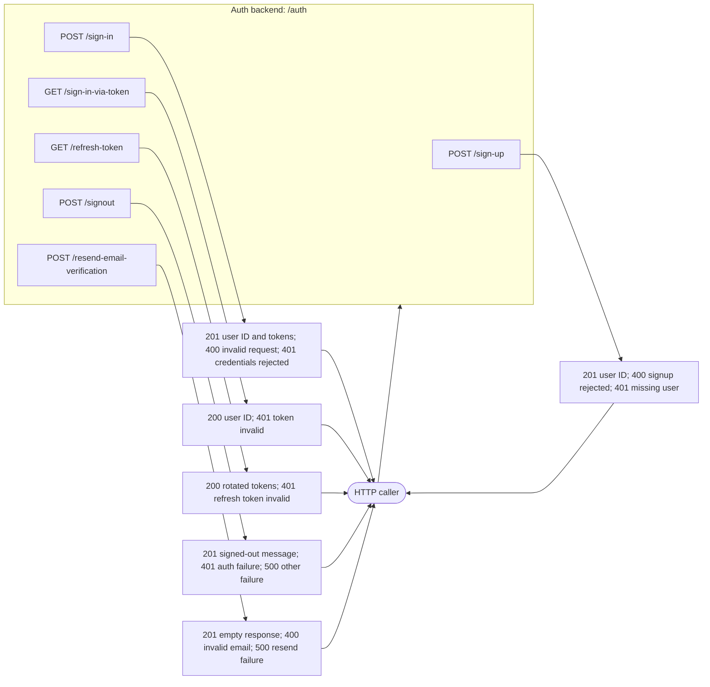
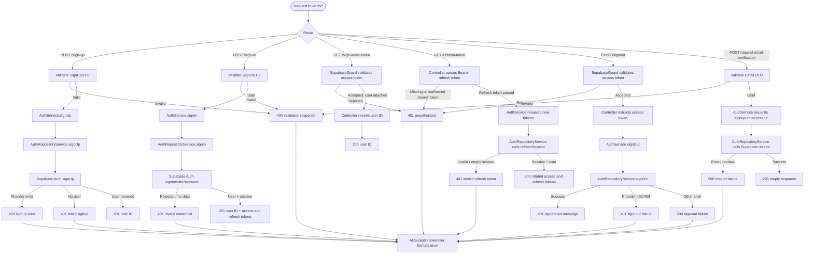

# Authentication diagrams

<!-- -MIMO: Separate auth black-box and detailed backend flows from endpoint contract documentation. -->

## Black-box backend

The API boundary and caller-visible outcomes for `/auth` endpoints.

## Detailed backend flow

The controller validates request DTOs and rejects unknown body fields. `AuthService` shapes successful results, `AuthRepositoryService` calls Supabase Auth, and `AllExceptionsHandler` formats failures. The global filter returns generic `500` JSON for unexpected non-HTTP errors.
