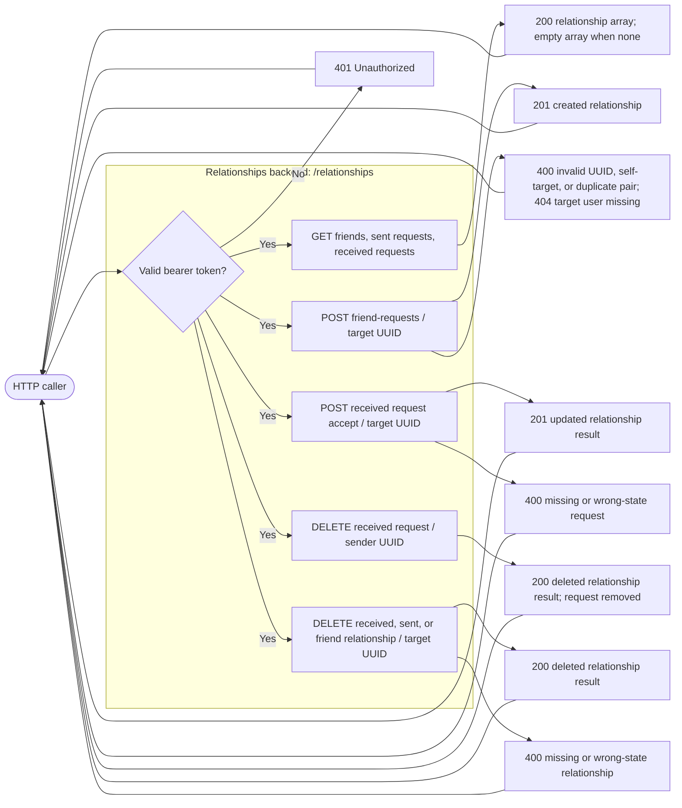
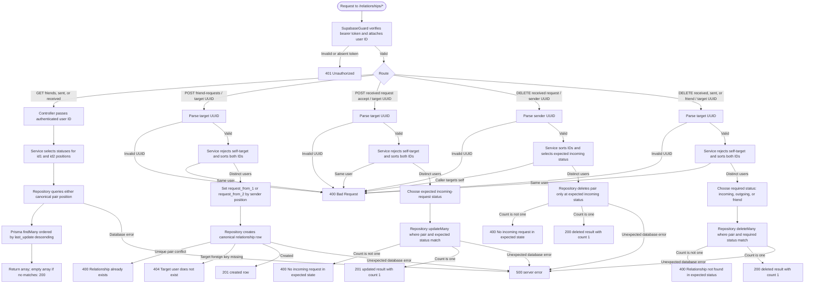
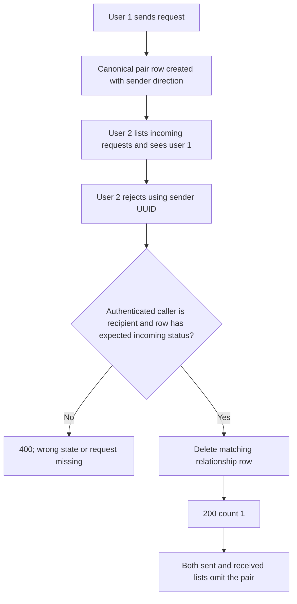
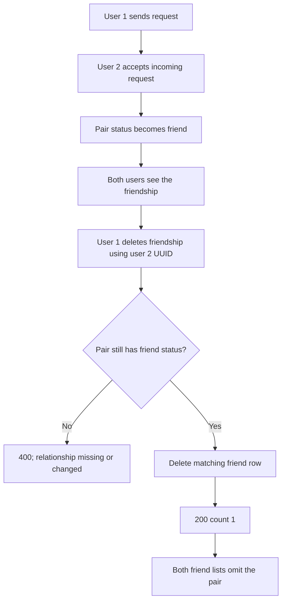
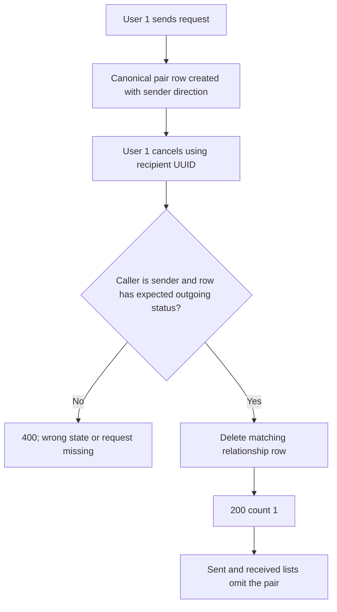

# Relationships backend diagrams

<!-- -MIMO: Separate relationship black-box and detailed backend flows from endpoint contract documentation. -->

## Black-box backend



## Detailed backend flow



`RelationshipsController` applies `SupabaseGuard`, UUID parsing, and `AllExceptionsHandler` to every route. Pair IDs are sorted before mutation, so one database row represents both directions. Accept uses a conditional update; if another operation changes the row first, the expected-status check returns `400` instead of overwriting that newer state.

## Scenario 2: user 1 sends and user 2 rejects

```mermaid
flowchart LR
    U1([User 1]) -->|Bearer token; POST request to user 2| API[Relationships API]
    API -->|201 pending request| U1
    API -->|Incoming request appears| U2([User 2])
    U2 -->|Bearer token; DELETE received request for user 1| API
    API -->|200 {count: 1}; request removed| U2
    API -->|Request absent from sent list| U1
```



## Scenario 1: user 1 sends, user 2 accepts, then user 1 unfriends

```mermaid
flowchart LR
    U1([User 1]) -->|Send request| API[Relationships API]
    API -->|201 pending request| U1
    U2([User 2]) -->|Accept request| API
    API -->|201 friendship| U2
    API -->|Friendship visible in both lists| U1
    U1 -->|DELETE friend relationship| API
    API -->|200 {count: 1}; friendship removed| U1
    API -->|Friendship removed from list| U2
```



## Scenario 3: user 1 sends and cancels before user 2 acts

```mermaid
flowchart LR
    U1([User 1]) -->|Bearer token; POST request to user 2| API[Relationships API]
    API -->|201 pending request| U1
    U1 -->|Bearer token; DELETE sent request for user 2| API
    API -->|200 {count: 1}; request removed| U1
    API -->|No incoming request remains| U2([User 2])
```


