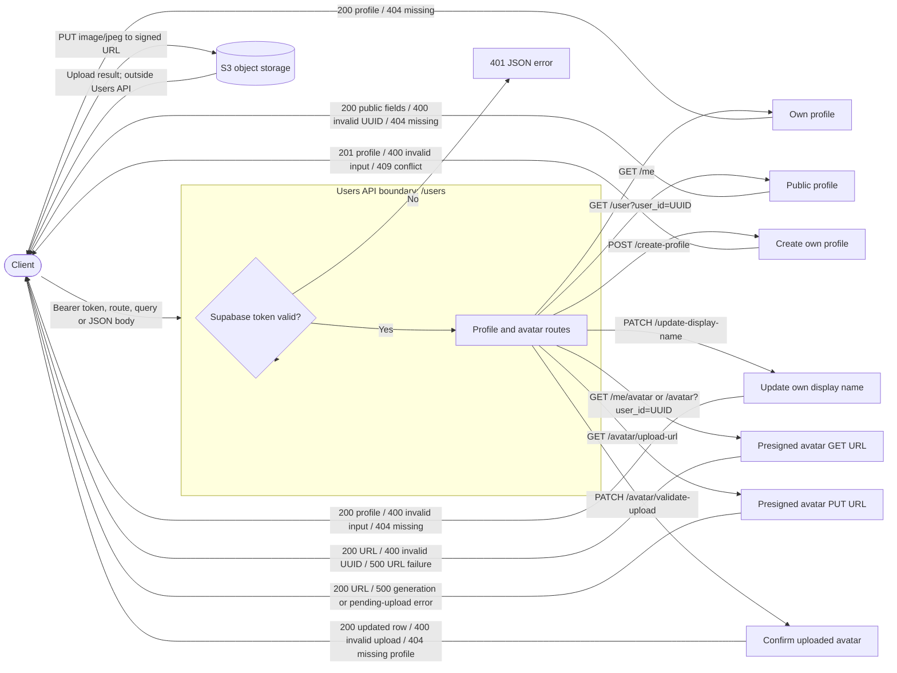
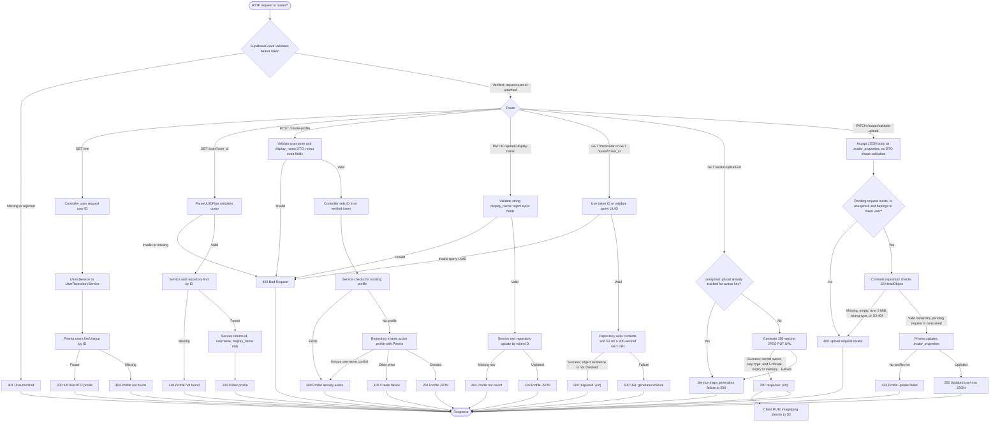

# Users diagrams

## Black-box scenario: profile requests

## Detailed scenario: validation, persistence, and avatar upload branches

The direct S3 upload happens outside the `/users` API. Avatar GET signing does not query Prisma or verify that the S3 object exists. Pending upload tracking is process-local and is consumed only after metadata verification succeeds.
