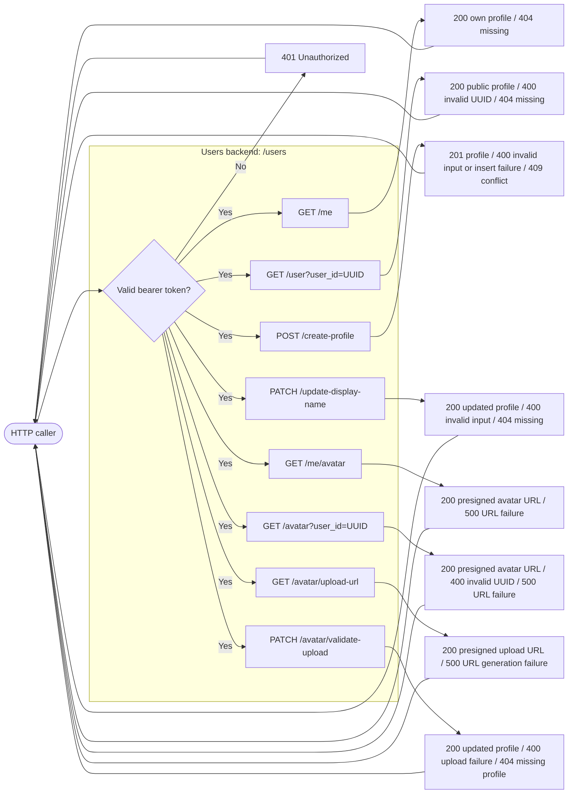
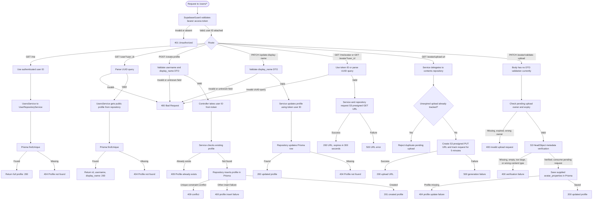

# Users backend diagrams

<!-- -MIMO: Separate users black-box and detailed backend flows from endpoint contract documentation. -->

## Black-box backend

## Detailed backend flow

The file transfer for an avatar goes directly to S3 using the presigned URL; it is outside the `/users` API boundary. `GET /users/avatar?user_id=...` currently lets any authenticated user request another user's avatar URL.
